# «Глазами ученика»: полный уровень 7 класса

Уровень 2 «Оборона купола» — от первого экрана до победы, без пропусков. Ученик Алия Серикова прошёл 20 случайных заданий, ошибся один раз и открыл следующий уровень. Снято 24 октября 2026.

| Показатель | Значение |
| --- | --- |
| Шагов в отчёте | 15 |
| Заданий в уровне | 20 |
| Решено | 20/21 |
| Итоговый счёт | 2586 |
| Точность | 95% |
| Звёзды | ⭐⭐⭐ |
| Ошибок в консоли | 0 |
| Открыт уровень | 3 |

## Что проверялось

- ✓ Знакомство: выбор роли и один постоянный короткий код ученика — один раз.
- ✓ Главное меню: профиль, три языка, переключатель темы, «Продолжить».
- ✓ Список уровней: карточки 7 класса с номером, темой и описанием.
- ✓ Выбор миссии: пять режимов одного уровня, старт «Обороны купола».
- ✓ Брифинг истории: место действия, задача этапа и герои главы.
- ✓ Игровое поле: щит города, таймер, пауза, очки и уровень пилота.
- ✓ Первое задание: тип задания, прогресс «вопрос 1 / 20», три подсказки.
- ✓ Подсказка: объясняет закон и ход мысли, а не выдаёт готовый ответ.
- ✓ Неверный ответ: −10 HP, остаток попыток, правильный ответ не раскрывается.
- ✓ Верный ответ: очки, щит и объяснение — почему именно так.
- ✓ Задание «сопоставь»: пары собираются кликами, проверка после всех пар.
- ✓ Задание «отметь все»: верных вариантов несколько, засчитывается только полный набор.
- ✓ Середина уровня: 10 заданий из 20, счёт и щит города в норме.
- ✓ Победа: итоги, точность, три звезды, опыт, кристаллы и достижения.
- ✓ После победы: уровень отмечен пройденным, открыт следующий, прогресс сохранён.

## Шаги прохождения

### 1. Знакомство

Один раз выбираем роль и имя. Короткий код ученика (4 символа) остаётся на всю трилогию 7–9.

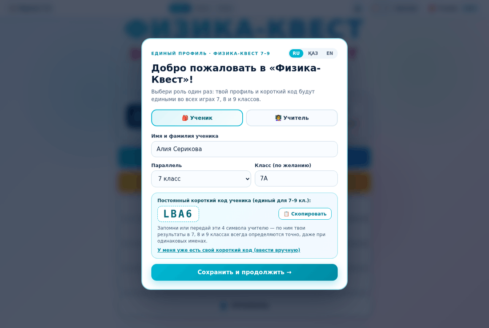

### 2. Главное меню

Семь кнопок. Профиль уже сохранён, «Продолжить» появится после первого уровня.

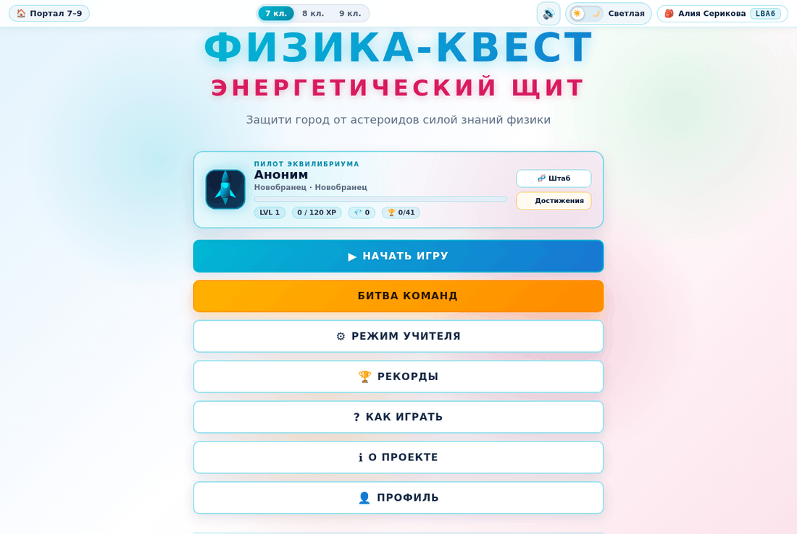

### 3. Список уровней

7 класс: карточки с номером, темой и описанием. Все уровни открыты — можно играть в любом порядке.

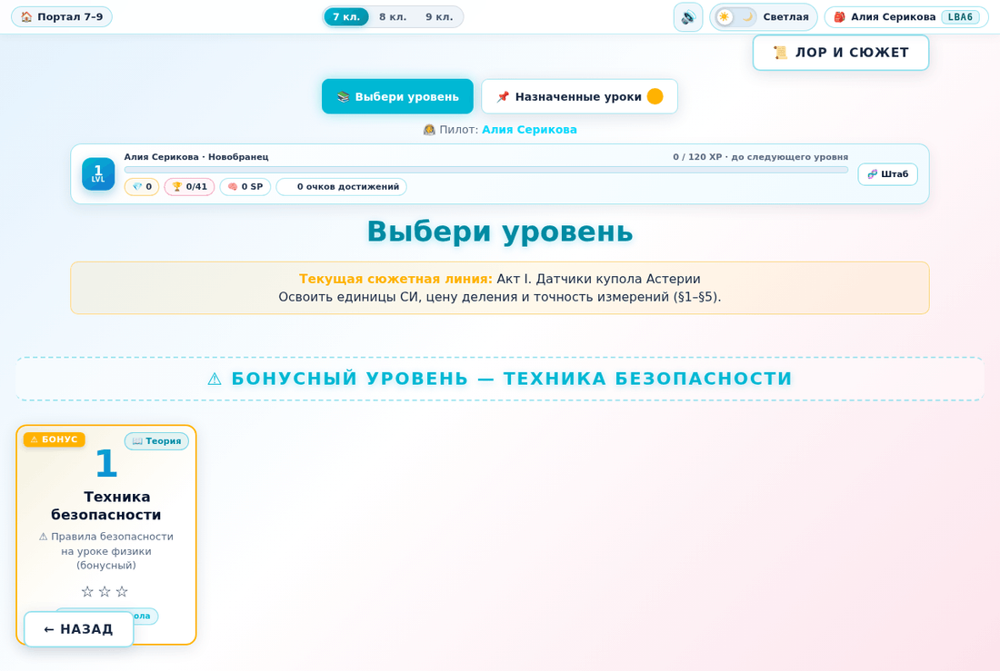

### 4. Выбор миссии

Пять режимов прохождения одного и того же уровня: оборона, блиц, выживание, босс, сбор.

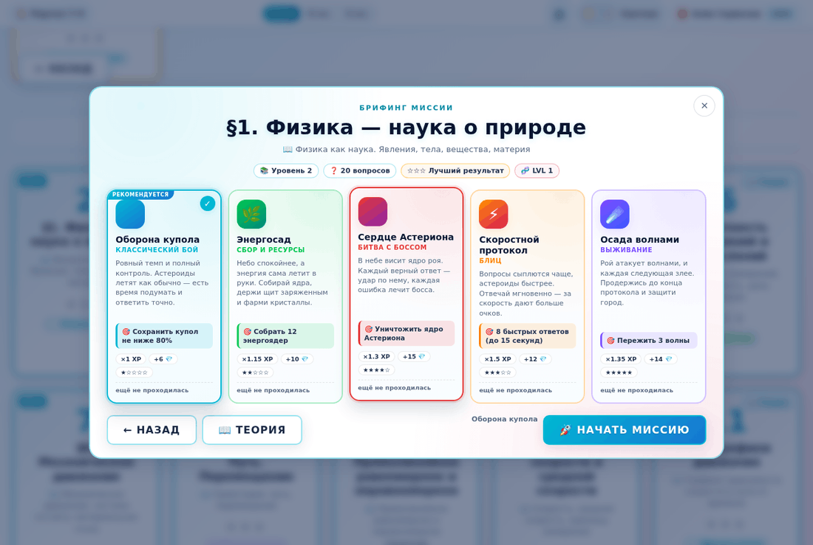

### 5. Брифинг истории

Перед уровнем — место действия, задача этапа и герои главы.

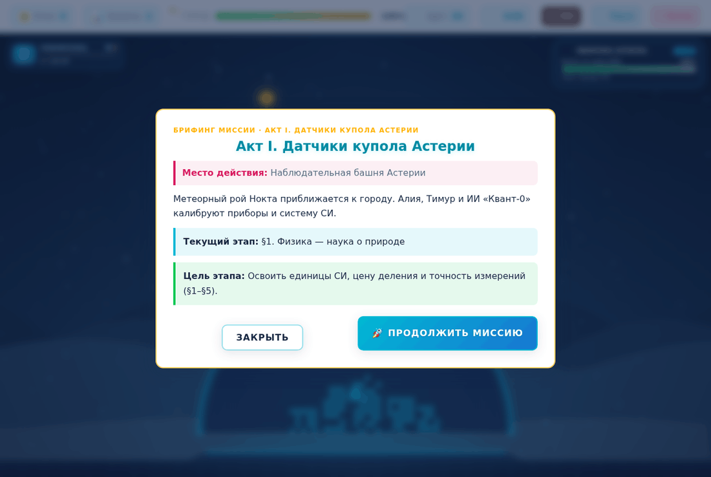

### 6. Игровое поле

Ракета защищает купол. Вверху очки, уровень, щит города, таймер, пауза и выход.

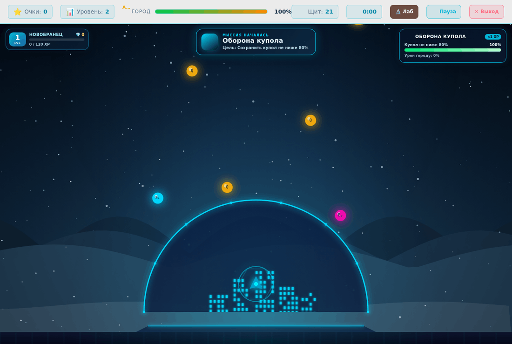

### 7. Первое задание

Задание приходит само. Видно тип, прогресс «вопрос 1 / 20» и три подсказки.

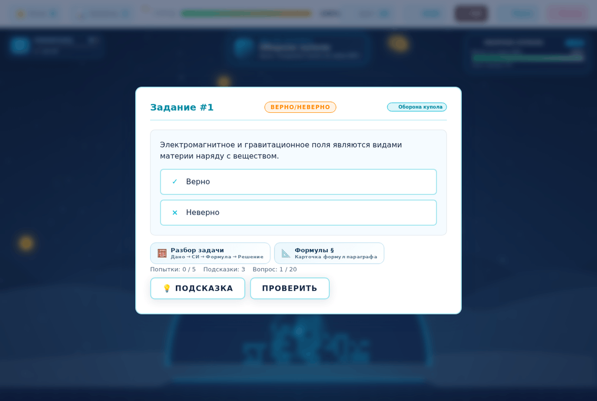

### 8. Подсказка

Подсказка объясняет закон и ход мысли, а не выдаёт готовый ответ. Их три на задание.

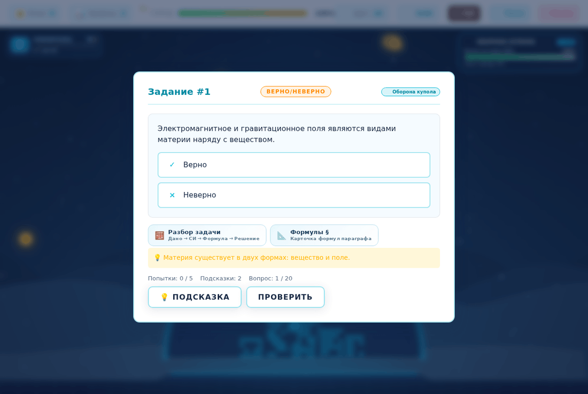

### 9. Неверный ответ

Правильный ответ не раскрывается — только остаток попыток (город при этом теряет 10 HP). Есть время подумать.

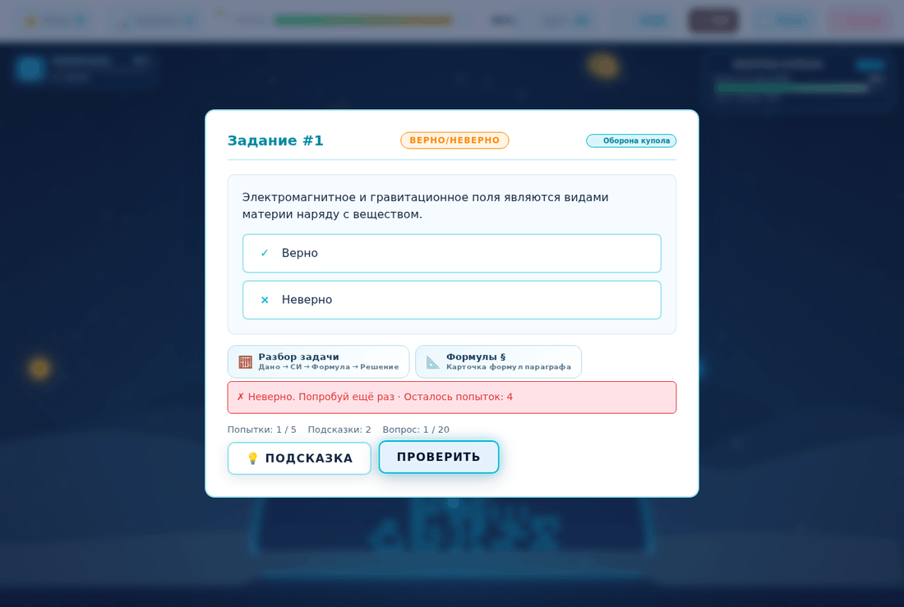

### 10. Верный ответ

Начисляются очки и щит, появляется объяснение — почему именно так.

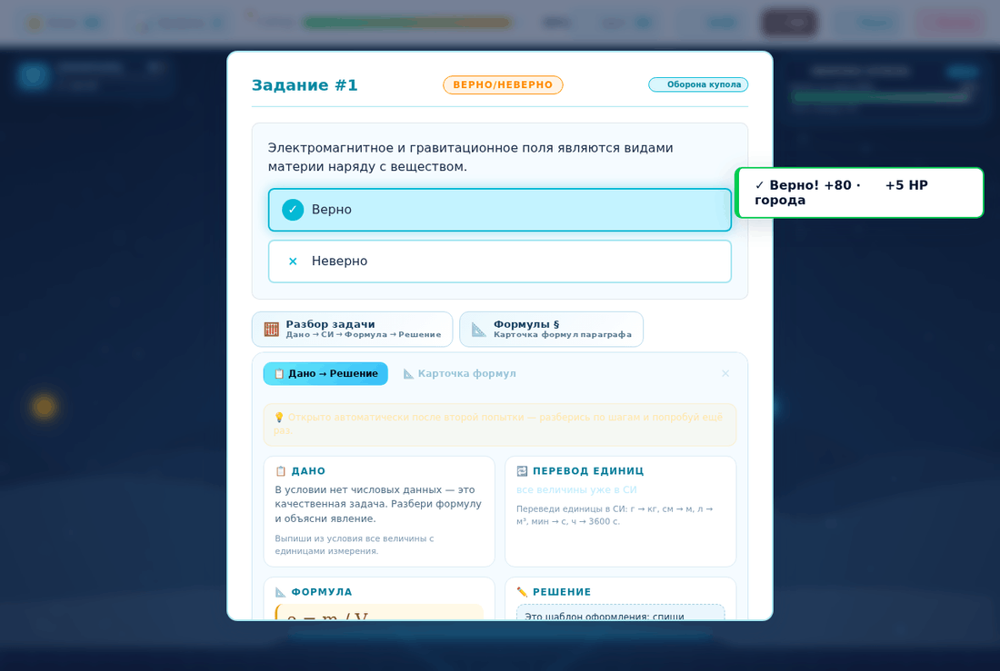

### 11. Задание «сопоставь»

Пары соединяются кликами: слева величина, справа прибор или единица СИ. После последней пары ответ проверяется автоматически.

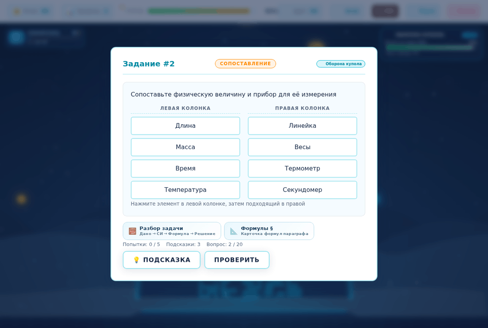

### 12. Задание «отметь все»

Верных вариантов несколько — нужно отметить все, иначе ответ не засчитывается.

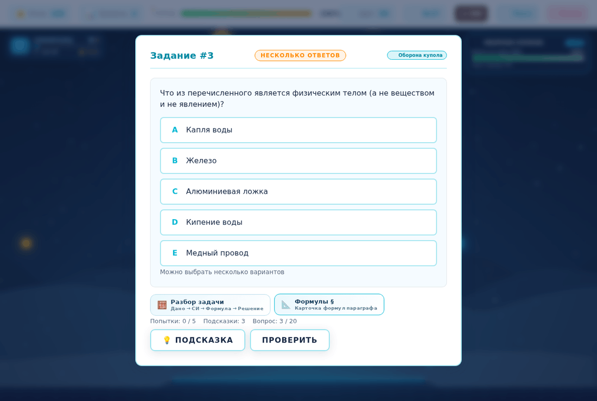

### 13. Прохождение уровня (10 из 20)

Решено 10 заданий из 20, очки: 1251, щит города: 100%.

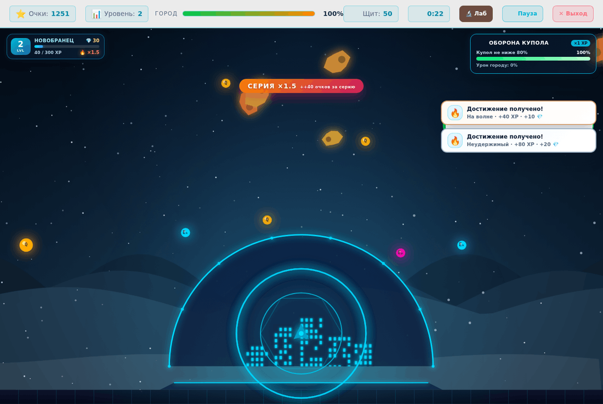

### 14. Победа

Заданий решено 20 из 21 попыток, очки 2586. Итоги, звёзды и переход к следующему уровню. Награды за уровень: Первая победа, На все три, Броня города.

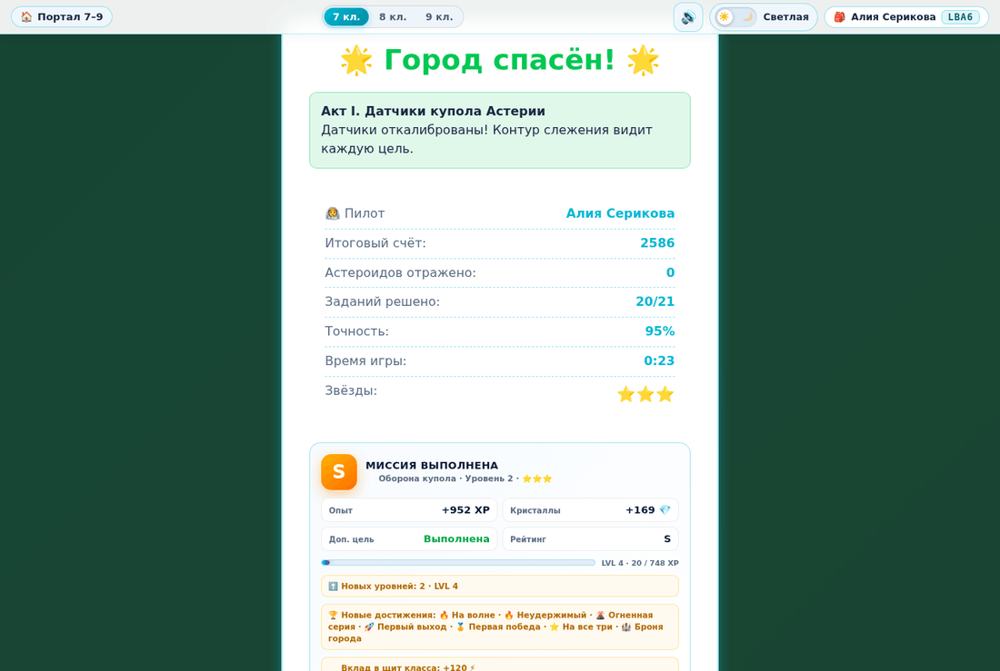

### 15. После победы

Уровень отмечен пройденным, прогресс сохранён: {"unlockedLevel":3,"completedLevels":{"2":{"score":2586,"time":23437,"tasksSolved":20,"accuracy":95,"stars":3}},"bestSco

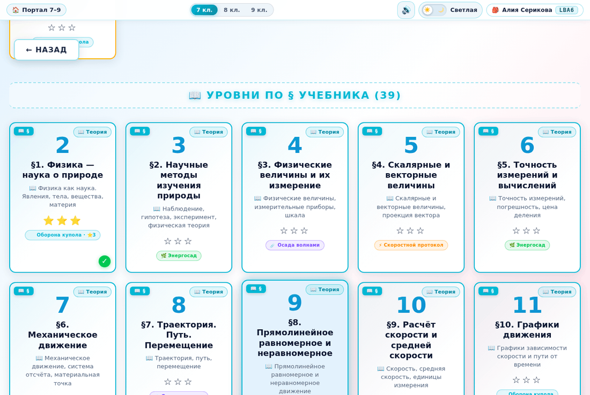

## Итог уровня

```json
{"unlockedLevel":3,"completedLevels":{"2":{"score":2586,"time":23437,"tasksSolved":20,"accuracy":95,"stars":3}},"bestScore":2586}
```

Экран победы: счёт 2586, заданий 20/21, точность 95%, время 0:23, звёзды ⭐⭐⭐, ошибок в консоли 0.

## Что нашлось и что исправлено

### Задание спрашивалось дважды, счёт переваливал за план

Если попытки заканчивались, задание возвращалось и засчитывалось повторно: при плане 20 заданий счётчик доходил до 21. Причина найдена инструментированием `Game.checkAnswer` в живом браузере. В `shared/game.js` добавлен флаг `taskResolved`: он закрывает повторную проверку уже решённого задания и сбрасывается при старте уровня. Повторный прогон: 20 решённых из 20 заданий плана, победа наступает ровно на двадцатом.

### Кнопки «Разбор задачи» и «Формулы §» были белыми на белом

Панель разбора задачи была свёрстана для тёмных экранов, а окно задания — светлое: текст кнопок терялся. В конец `shared/platform.css` добавлен светлый блок стилей, ограниченный `#task-modal`, и отдельный блок `html[data-theme="dark"] #task-modal …`, который возвращает прежние тёмные значения. Заодно убран задвоенный значок 📐 в подписях (RU/KK/EN).

### Оффлайн-кэш затягивал папку со скриншотами

Генератор манифеста обходил `docs/` и складывал в оффлайн-кэш картинки отчёта. Папка исключена, манифест пересобран — 128 файлов приложения без документации.

## Как воспроизвести

```bash
node .work/playthrough.js 7 2   # заново снять 15 экранов
node .work/verify.js ru|kk|en              # 66 проверок на язык
```

Снимки снимаются через Chrome DevTools Protocol с обходом service worker и HTTP-кэша. Задания решаются теми же кликами по интерфейсу, что и у ученика; «Астероидов отражено: 0» на экране победы — потому что в этом прогоне метеориты не сбивались вручную.
