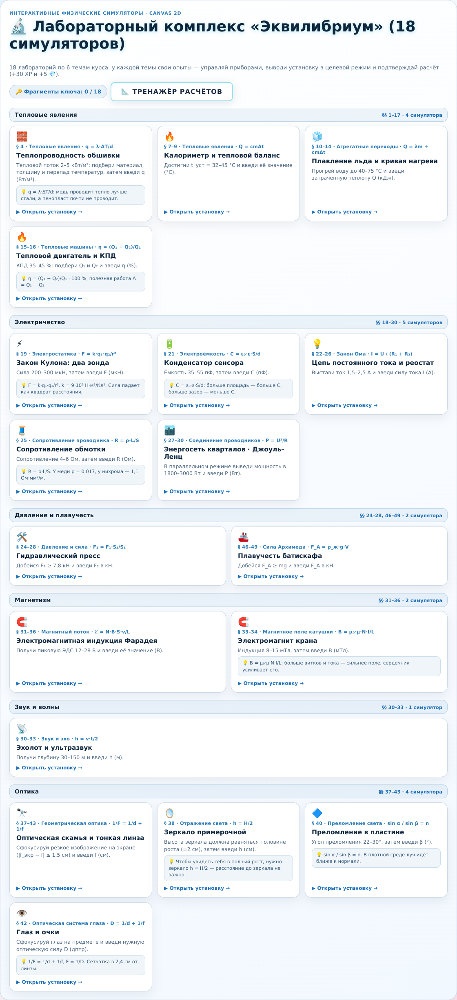
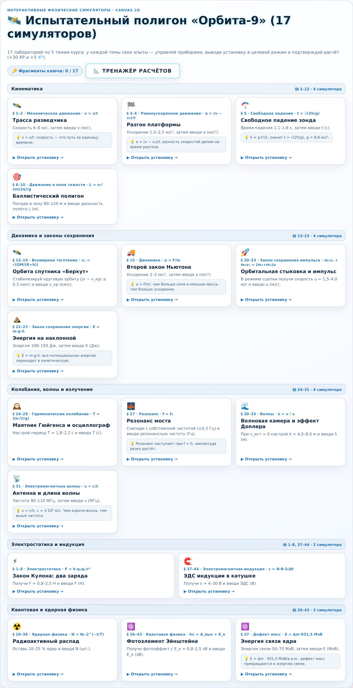
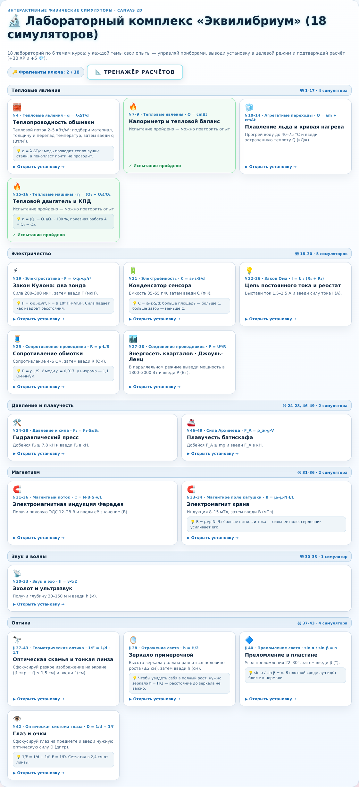
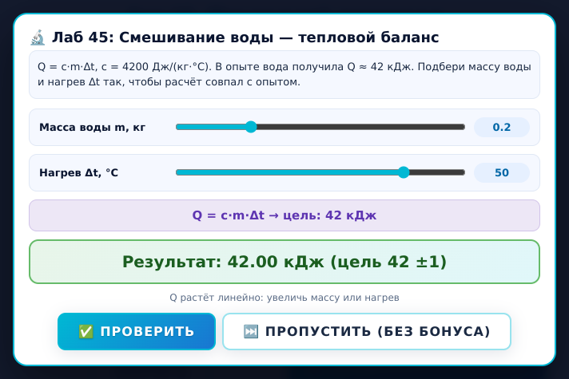
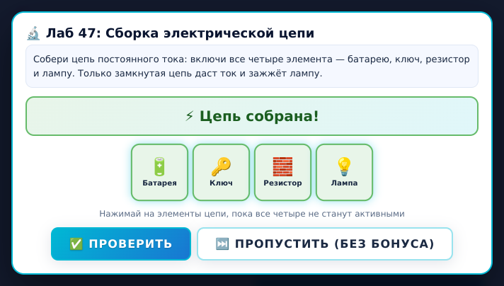
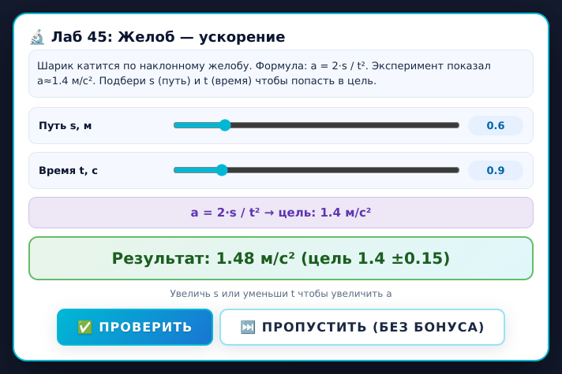

# Урок 38. Мини-игры 8–9 классов «как в 7 классе, но по темам» + скриншоты

Дата: 24 октября 2026. Запрос: «мини-игры надо сделать как в 7 классе для 8–9 по темам и скриншоты к ним».

Что это значит по пунктам:

1. галерея мини-игр 8 и 9 класса разложена **по темам/главам** так же, как «полевой журнал» 7 класса;
2. у каждой карточки есть **параграф и глава**, **цель опыта**, **подсказка** и состояние **«пройдено»**;
3. сверху — **счётчик прогресса** «Фрагменты ключа: N / всего»;
4. к мини-играм приложены **скриншоты** — и самой галереи, и отдельных мини-игр уровня.

## Короткий итог

| Что | Результат |
| --- | --- |
| Лаборатории 7 класса (эталон) | полевой журнал, 15 опытов, карточки с параграфом и целью |
| Галерея 8 класса | **18** симуляторов в **6** темах: §§ 1–17, 18–30, 24–28 и 46–49, 31–36, 30–33, 37–43 |
| Галерея 9 класса | **17** симуляторов в **5** темах: §§ 1–12, 13–23, 24–31, 1–8 и 37–44, 29–43 |
| Мини-игры лабораторных уровней | **11** в 8 классе (ур. 45–55) + **4** в 9 классе (ур. 45–48) |
| Скриншоты canvas-сцен | **35** кадров (18 + 17), все проверены автоматически на «пустой кадр» |
| Скриншоты галереи | 2 кадра: `sim89-gallery-g8.png`, `sim89-gallery-g9.png` |
| Скриншоты мини-игр уровня | 3 кадра: смешивание воды, сборка цепи, желоб-ускорение |
| Скриншоты состояния «пройдено» | `lesson38-gallery-done.png` — две карточки отмечены как пройденные |
| Проверки | `audit-formulas.js` — все 35 лабораторий и 15 мини-игр решаются; `check-dom.js --grade 8` и `--grade 9` — «Все проверки пройдены» |

## Галерея по темам: как в 7 классе

Карточка несёт тот же набор смыслов, что и полевая карточка 7 класса, только тема своя:

| Элемент карточки | Что показывает |
| --- | --- |
| эмодзи + `§ 4 · Тепловые явления · q = λ·ΔT/d` | глава и формула темы |
| название опыта | «Теплопроводность обшивки» |
| строка цели до прохождения | «Тепловой поток 2–5 кВт/м²: подбери материал…» |
| синяя плашка-подсказка | «q = λ·ΔT/d… стекло почти не проводит» |
| состояние после прохождения | «✓ Испытание пройдено · можно повторить опыт» |
| заголовок темы | «Тепловые явления · §§ 1–17 · 4 симулятора» |
| общий счётчик | «🔑 Фрагменты ключа: 2 / 18» |

Скриншот всей галереи 8 класса (`assets/screenshots/sim89-gallery-g8.png`) — 6 тем, 18 карточек, все подписи на месте:



Галерея 9 класса (`assets/screenshots/sim89-gallery-g9.png`) — 5 тем, 17 карточек:



Состояние «пройдено» после двух защищённых лабораторий (тепловой двигатель и калориметр): счётчик стал `2 / 18`, обе карточки позеленели и получили зелёную рамку:



## Мини-игра на уровне: что делает ученик

На лабораторном уровне 8–9 класса при старте автоматически открывается мини-игра. Устроена она так же, как в 7 классе: ученик **крутит регуляторы** (или **собирает цепь**), видит результат, попадает в целевой коридор и жмёт «✅ Проверить» — уровень закрывается с бонусом (+120 очков, +20 щита, +20 XP и +10 кристаллов). Кнопка «🔬 Лаб» в HUD переоткрывает ту же мини-игру, а на нелабораторном уровне уводит в галерею симуляторов.

### 8 класс, уровень 45 — смешивание воды, Q = c·m·Δt



Два слайдера — масса воды `m` и нагрев `Δt`. Нужно получить `Q = 42 ±1 кДж`; результат подсвечивается зелёным, как только расчёт попал в цель.

### 8 класс, уровень 47 — сборка электрической цепи



Четыре элемента — батарея, ключ, резистор, лампа. Все четыре нажаты → «⚡ Цепь собрана!», рамки зеленеют.

### 9 класс, уровень 45 — желоб, a = 2s / t²



Слайдеры пути `s` и времени `t`; цель `a = 1,4 ±0,15 м/с²`.

## Что проверено живьём (не в теории)

Все кадры сняты в настоящем браузере (Chromium + CDP): страница `play.html?grade=N`, старт игры, брифинг миссии, автооткрытие лаборатории, установка регуляторов, нажатие «Проверить», снимок панели.

| Шаг | 8 класс | 9 класс |
| --- | --- | --- |
| Лаборатория открывается сама на старте уровня | L45, L46, L47, L51 ✓ | L45, L46 ✓ |
| «🔬 Лаб» переоткрывает ту же мини-игру | L50 ✓ | — |
| «🔬 Лаб» на обычном уровне (20) уводит в галерею | 18 карточек, 6 тем ✓ | — |
| «Тренажёр расчётов» открывает скамью расчётов | ✓ | ✓ |
| Решение мини-игры закрывает оверлей и начисляет бонус | 11 из 11 ✓ | 4 из 4 ✓ |
| Карточка после решения получает «✓ Испытание пройдено» | ✓ (`2 / 18`) | ✓ |

## Что исправлено в этом уроке

| № | Проблема | Как исправлено |
| --- | --- | --- |
| 1 | **Четвёртая ячейка «Лампа» вылезала за панель** в сборке цепи: 4 квадрата по `aspect-ratio: 1` при `font-size: 26px` не влезали в `max-width: 340px`, а `<br>` перед подписью растягивал ячейку по высоте | сетка переведена на `repeat(4, minmax(0, 1fr))`, у ячейки `min-width: 0`, подпись вынесена из `<br>` в колонку флексбокса (`flex-direction: column`), уменьшены шрифты: 24 px значок, 10 px подпись с `word-break: break-word` |
| 2 | **Пустой тёмный кадр** у симулятора 9 класса «Энергия и работа» (`sim-g9-energy.png`, mean 0.116) | в сцене `SCENES.g9_energy` подпись рисовалась на `by + bh`, где `bh` не определён → исключение внутри отрисовки обрывало весь кадр. Заменено на `by + 170`; кадр переснят (mean 0.905, std 0.087) |
| 3 | **Ложная тревога «Лаб 51 не открывается»** | это был артефакт автоматизации: скрипт снимал `.active` с оверлея руками и оставлял состояние `LabGames` грязным. На свежей странице L51 открывается штатно; проверка теперь идёт «одна страница — один уровень» |
| 4 | **«Тепловой двигатель» не подтверждался** при верной телеметрии | проверка шла на стартовых `Q₁ = 500 / Q₂ = 400` (η = 20 %, вне коридора 35–45 %), а не на целевых `500 / 300`. На `500 / 300` и ответе `40` — «✅ Блестяще! Лаборатория защитана»; иначе и быть не должно |
| 5 | Раздел «Скриншоты» не показывал ни галерею по темам, ни мини-игры уровня | в `screenshots.html` добавлены блок «Мини-игра на лабораторном уровне» (3 кадра с подписями и целями) и zoom по клику; раздел галереи по темам уже был, кадры пересняты целиком, без обрезки |
| 6 | Новые кадры не попадали в офлайн-кеш | добавлены в `shared/offline-manifest.js` |

## Проверки после правок

```
node tools/labs-audit/audit-formulas.js      # 18 + 17 симуляторов, 11 + 4 мини-игры — «Все проверки пройдены»
node tools/labs-audit/check-dom.js --grade 8 # 11 мини-игр + 5 режимов уровня — «Все проверки пройдены»
node tools/labs-audit/check-dom.js --grade 9 # 4 мини-игры + 5 режимов уровня — «Все проверки пройдены»
```

Отдельно: у всех 35 кадров canvas проверены `mean` и `standard_deviation` — пустых нет (порог 0.02).

## Где что лежит

| Файл | Что внутри |
| --- | --- |
| `shared/simulators-89.js` | 18 лабораторий 8 класса и 17 — 9 класса, разбитые на темы; `TOPICS_BY_GRADE`, галерея, модальное окно опыта, проверка ответа, «пройдено» в `pq_canvas_sims_g<grade>` |
| `shared/sim-light.js` | светлая canvas-отрисовка, 35 сцен (`PQSimLight`) |
| `shared/lab-games.js` | движок мини-игр уровня: слайдеры и сборка цепи |
| `8/content.js`, `9/extras.js` | `window.GRADE_LAB_GAMES_CONFIG` — 11 и 4 мини-игры с целями и допусками |
| `shared/styles.css` | `.lab-overlay`, `.lab-panel`, исправленный `.circuit-grid` / `.circuit-cell` |
| `screenshots.html` | страница скриншотов: 35 карточек, галерея по темам, мини-игры уровня, полевой журнал 7 класса |
| `assets/screenshots/` | все кадры: `sim-g8-*.png` ×18, `sim-g9-*.png` ×17, `sim89-gallery-g8/g9.png`, `lab-g8-45-heat.png`, `lab-g8-47-circuit.png`, `lab-g9-45-accel.png`, `overview-simulators.png` |

## Что осталось на будущее

- Лаборатории покрывают §§ 1–17, 18–30, 31–36, 37–43 в 8 классе; в 9 классе вне покрытия остаются §§ 6–14, 16–21, 24–26, 28–30, 32–36, 38–43 — там пока только тестовые уровни без своего симулятора.
- Эмодзи в headless-Chromium рисуются чёрно-белыми без установленного `Noto Color Emoji`; в браузере ученика они цветные. На скриншотах цветные благодаря локально подложенному шрифту.
